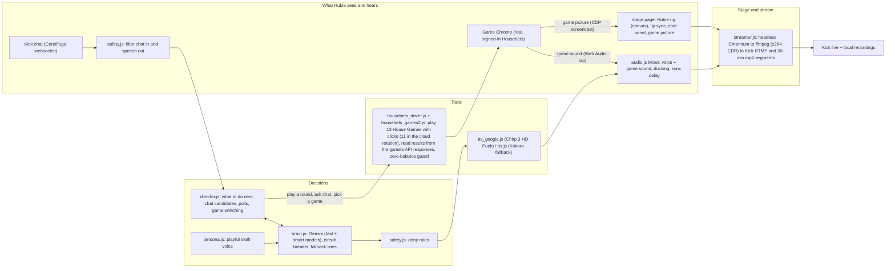

# Hubie, live 24/7

Hubie is an AI sloth who runs a Kick stream (kick.com/househubie) with no human in the loop. He plays Housebets House Games in
zero-stake play mode (demo money only, never real balance), talks in a lip-synced voice, hears the game's own sound, reads Kick chat,
and asks chat to help with decisions ("hit or stand, chat?"). He stays safe: 18+ and play-money messaging only, no money advice,
no claims about winning.

## How it works (agents and tools)

* **Brain**: Gemini writes every line (fast model for reactions, smart model for replies). If the model is slow or down, a circuit
  breaker switches to a bank of pre-written lines so the stream never goes silent.
* **Hands**: a Playwright driver attaches to a real Chrome that a human signed into Housebets once. It plays by clicking, reads results
  from the game's network responses, and refuses to play unless the balance is exactly zero (play mode).
* **Voice**: Google Cloud TTS (Puck) with Kokoro as a free local fallback; the audio mixer lowers game sound under the voice.
* **Watchdogs**: supervisor/systemd restarts, an encoder watchdog that also notices when the link to Kick is lost (ffmpeg keeps recording after Kick
  drops it, and Kick ends any single stream after about 48 hours) and reconnects with a growing wait, a game-browser-gone watchdog, a disk janitor, and a "technical break" card when the game
  browser needs a human (for example a site check, which Hubie never tries to pass).

## Setup (one page)

You need: a Linux VM (4+ vCPU, 8 GB, Ubuntu 24.04), Node 24, ffmpeg, Google Chrome, a Gemini API key, a Google Cloud TTS key,
and a Kick stream key.

1. `git clone` this repo to the VM as `~/hubie`, then `cp .env.example .env` and fill in `GEMINI_API_KEY`, `GOOGLE_TTS_API_KEY`,
   `KICK_RTMP_URL`, `KICK_STREAM_KEY`, `KICK_CHANNEL`, `KICK_CHATROOM_ID`.
2. `bash deploy/setup_cloud.sh` installs Chrome, ffmpeg, Xvfb, a remote-screen viewer (noVNC over HTTPS) and the systemd services
   (`hubie-chrome`, `hubie-live`, and friends). It also turns off automatic updates so nothing restarts mid-run.
3. Open the remote screen once (restrict the firewall to your own IP), sign in to Housebets in the game Chrome yourself, switch to
   play mode so the balance is zero. A human signs in and solves any site check; Hubie never does.
4. `sudo systemctl enable --now hubie-live` starts the show. `sudo systemctl disable --now hubie-live` stops it.
5. Logs: `~/hubie/logs/live.log`; recordings: `~/hubie/recordings/` (30-minute mp4 segments).

Local testing on a Mac: `tools/launch_game_browser.sh`, then `node server/main.js --out=test.mp4 --minutes=2 --game=housebets`.
Tests: `npm test`.

## Notes

* Roulette and Max Win are left out of the cloud rotation (`HUBIE_SKIP_GAMES=roulette,max-win`) because software rendering on a GPU-less VM
  can't keep their animation smooth; asking for them gets a friendly "I haven't learned that one yet". A GPU VM would bring them back.
* No fake games anywhere: the stage always shows the real Housebets game.
* Chat safety: every chat line is filtered before the brain sees it and every spoken line is filtered again (no money advice, no
  winning claims, 18+ and play-money messaging, refusals for anything unsafe). Kick's own AI moderation and banned words are set on the
  channel; Hubie does not ban or time out users himself.
* Housebets pages sit behind a bot check. The one-time sign-in and any check are done by a human before going live; Hubie never tries to
  pass or evade a check, and shows a "technical break" card instead.

## Stack

Node 24 (ESM), Playwright 1.49 and a real Google Chrome on Xvfb, ffmpeg (x264 CBR 5.5 Mbps, 1080p30, RTMP to Kick plus 30-minute mp4
segments), Gemini (`gemini-3.1-flash-lite` fast, `gemini-3.5-flash` smart), Google Cloud TTS Chirp 3 HD "Puck" with Kokoro as local
fallback, Kick chat over its Centrifugo websocket, Canvas2D skeletal sloth rig, systemd on a GCP e2-standard-8 VM in Finland.

Art: `assets/rig` holds the cut-out Hubie layers used by the rig (official Hubie character art; the character belongs to Housebets).
